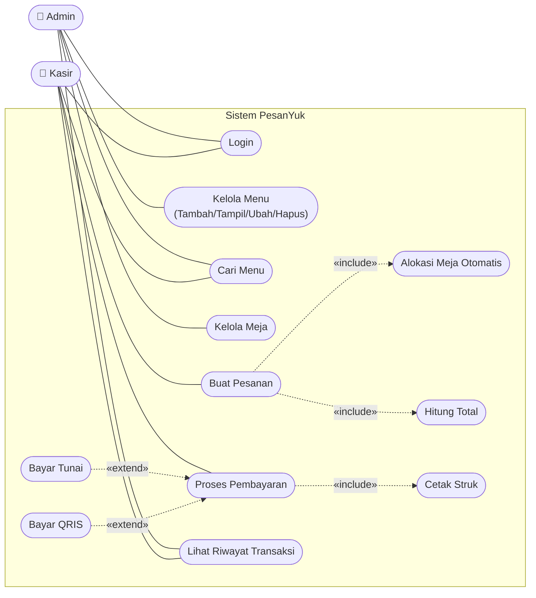
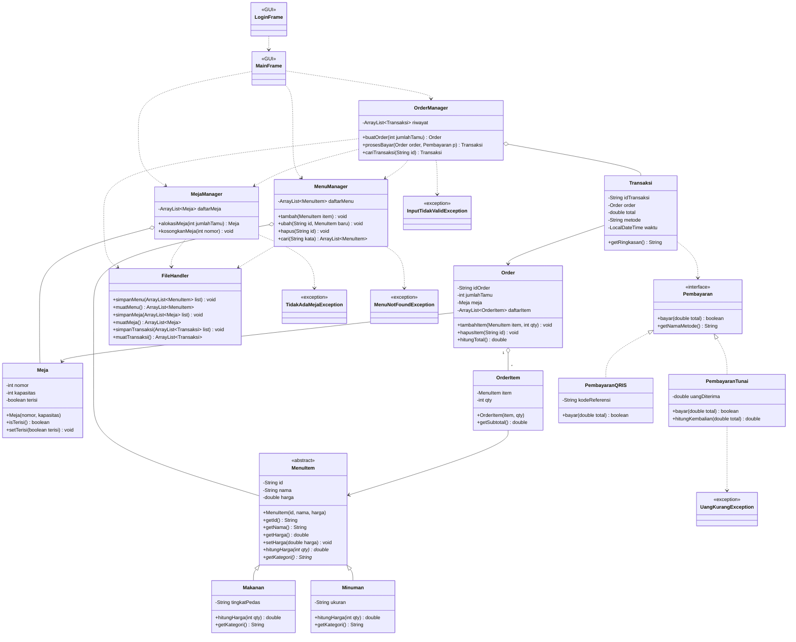

# PesanYuk: Analisis Kebutuhan dan Desain Sistem

**Final Project Praktikum Pemrograman Berorientasi Objek (PBO)**
D3 Teknik Informatika PSDKU Lamongan | Bahasa: Java | Antarmuka: GUI (Java Swing) | Penyimpanan: File

| | |
|---|---|
| Nama aplikasi | **PesanYuk** |
| Tema | Restaurant Point of Sale |
| Subjudul | Aplikasi Kasir Restoran dengan Penempatan Meja Otomatis |
| Kelompok | _(isi nama dan NIM anggota, maks. 3 orang)_ |
| Tahap | Minggu 1: Analisis dan Perancangan Sistem |

---

## 1. Pendahuluan

### 1.1 Latar Belakang
Pada restoran skala kecil dan menengah, pencatatan pesanan, penentuan meja, dan perhitungan pembayaran sering dilakukan secara manual. Cara ini rawan salah hitung, pesanan tertukar, penempatan meja yang kurang efisien, dan rekap transaksi yang sulit ditelusuri. Selain pembayaran tunai, pelanggan kini juga banyak menggunakan QRIS, sehingga kedua metode perlu tercatat dalam satu sistem.

**PesanYuk** dirancang sebagai aplikasi kasir (Point of Sale) berbasis GUI yang membantu kasir mencatat pesanan, memilih meja secara otomatis, memproses pembayaran tunai maupun QRIS, dan menyimpan seluruh transaksi ke file. Aplikasi dibangun dengan Java dan menerapkan konsep Pemrograman Berorientasi Objek.

### 1.2 Rumusan Masalah
1. Bagaimana merancang aplikasi kasir restoran yang mencatat pesanan makanan dan minuman dengan benar?
2. Bagaimana sistem menentukan meja yang sesuai dengan jumlah tamu secara otomatis?
3. Bagaimana mengimplementasikan pembayaran tunai dan QRIS dalam satu alur transaksi?
4. Bagaimana menerapkan konsep OOP (Encapsulation, Inheritance, Polymorphism, Abstraction) pada aplikasi ini?

### 1.3 Tujuan
1. Membangun aplikasi kasir restoran berbasis GUI dengan Java.
2. Menyediakan fitur alokasi meja otomatis berdasarkan jumlah tamu.
3. Menyediakan pembayaran tunai (dengan kembalian) dan QRIS.
4. Menyimpan dan membaca data menu, meja, dan transaksi menggunakan file.
5. Menerapkan seluruh konsep OOP yang disyaratkan pada instruksi Final Project.

### 1.4 Batasan Masalah
1. Metode pembayaran terbatas pada **tunai** dan **QRIS** (QRIS berupa simulasi kode referensi, tanpa integrasi payment gateway).
2. Aplikasi berjalan lokal (satu komputer), tanpa jaringan dan tanpa database; data disimpan dalam **file**.
3. Terdapat dua peran pengguna: **Admin** dan **Kasir**.
4. Fitur reservasi meja, delivery, dan manajemen stok bahan baku tidak termasuk cakupan.

---

## 2. Analisis Kebutuhan

### 2.1 Identifikasi Permasalahan
- Pencatatan pesanan manual rawan salah hitung dan pesanan tertukar.
- Penentuan meja manual membuat alokasi tidak efisien (misalnya 2 tamu menempati meja 8 kursi).
- Rekap transaksi harian sulit dilacak.
- Pembayaran tunai dan QRIS belum tercatat dalam satu sistem.

### 2.2 Aktor

| Aktor | Peran |
|---|---|
| Admin | Mengelola menu dan meja, mencari menu, melihat riwayat transaksi |
| Kasir | Mencari menu, membuat pesanan, memproses pembayaran, mencetak struk, melihat riwayat transaksi |

### 2.3 Kebutuhan Fungsional

| Kode | Kebutuhan | Aktor |
|---|---|---|
| FR-01 | Login sesuai peran (Admin / Kasir) | Admin, Kasir |
| FR-02 | Kelola menu: tambah, tampil, ubah, hapus (makanan / minuman) | Admin |
| FR-03 | Cari menu berdasarkan nama atau kategori | Admin, Kasir |
| FR-04 | Kelola data meja (nomor dan kapasitas) | Admin |
| FR-05 | Buat pesanan: input jumlah tamu, pilih menu dan jumlah | Kasir |
| FR-06 | Alokasi meja otomatis (best-fit: kapasitas terkecil yang mencukupi) | Sistem |
| FR-07 | Hitung subtotal, pajak, dan total pesanan | Sistem |
| FR-08 | Pembayaran tunai (hitung kembalian) dan QRIS | Kasir |
| FR-09 | Cetak struk (tampil di GUI dan simpan ke file) | Kasir |
| FR-10 | Lihat dan cari riwayat transaksi | Admin, Kasir |
| FR-11 | Validasi input (qty > 0, uang cukup, field tidak kosong, ID unik) | Sistem |
| FR-12 | Simpan dan baca data menu, meja, transaksi dari file | Sistem |
| FR-13 | Penanganan kesalahan dengan custom exception | Sistem |

### 2.4 Kebutuhan Non-Fungsional

| Kode | Kebutuhan |
|---|---|
| NFR-01 | Antarmuka GUI sederhana dan mudah digunakan kasir |
| NFR-02 | Data tidak hilang saat aplikasi ditutup (persisten di file) |
| NFR-03 | Aplikasi tidak crash saat input salah; tampil pesan error yang jelas |
| NFR-04 | Struktur kode modular, tiap kelas punya satu tanggung jawab jelas |

### 2.5 Aturan Bisnis
- **Alokasi meja:** pilih meja berstatus kosong dengan kapasitas >= jumlah tamu, ambil yang kapasitasnya paling kecil. Jika tidak ada, tampilkan pesan "Meja penuh".
- **Status meja:** menjadi terisi saat pesanan dibuat dan kembali kosong setelah pembayaran lunas.
- **Harga:** `Makanan` dihitung `harga x qty`; `Minuman` dihitung `(harga + tambahan ukuran) x qty`.
- **Pajak:** 10% dari subtotal (nilai dapat disesuaikan kelompok).
- **Tunai:** uang diterima harus >= total, kembalian = uang diterima - total.
- **QRIS:** sistem membuat kode referensi pembayaran sebagai simulasi, status lunas setelah kasir mengonfirmasi.

### 2.6 Alur Proses Bisnis Utama (Kasir)

```
Login
  -> Input jumlah tamu
  -> Sistem memilih meja otomatis (best-fit)
  -> Pilih menu + jumlah (makanan / minuman)
  -> Sistem menghitung subtotal, pajak, total
  -> Pilih metode bayar (Tunai / QRIS)
  -> Validasi pembayaran
  -> Simpan transaksi ke file
  -> Cetak struk
  -> Meja dikosongkan
```

---

## 3. Perancangan Sistem

### 3.1 Use Case Diagram



**Keterangan relasi:**
- `Buat Pesanan` meng-include `Alokasi Meja Otomatis` dan `Hitung Total`.
- `Proses Pembayaran` meng-include `Cetak Struk`.
- `Bayar Tunai` dan `Bayar QRIS` meng-extend `Proses Pembayaran`.

**Skenario singkat: Buat Pesanan dan Bayar**

| Langkah | Aksi Aktor | Respons Sistem |
|---|---|---|
| 1 | Kasir login | Sistem memvalidasi dan membuka menu Kasir |
| 2 | Kasir mengisi jumlah tamu | Sistem mencari meja kosong best-fit dan menampilkannya |
| 3 | Kasir memilih menu dan jumlah | Sistem menambah item dan menghitung total |
| 4 | Kasir memilih metode bayar | Sistem menampilkan form tunai atau kode QRIS |
| 5 | Kasir mengonfirmasi pembayaran | Sistem memvalidasi, menyimpan transaksi, mencetak struk, mengosongkan meja |

Alternatif: jika meja penuh, uang kurang, atau input tidak valid, sistem menampilkan pesan kesalahan dan proses tidak dilanjutkan.

### 3.2 Class Diagram



### 3.3 Penjelasan Rancangan Kelas

| Kelas | Jenis | Tanggung jawab |
|---|---|---|
| `MenuItem` | abstract class | Induk menu: id, nama, harga; method abstrak `hitungHarga()` dan `getKategori()` |
| `Makanan` | subclass | Menu makanan; atribut tingkat pedas |
| `Minuman` | subclass | Menu minuman; atribut ukuran (memengaruhi harga) |
| `Meja` | class | Nomor, kapasitas, status terisi |
| `OrderItem` | class | Satu baris pesanan: menu dan qty, hitung subtotal |
| `Order` | class | Pesanan: meja, jumlah tamu, daftar `OrderItem`, total |
| `Transaksi` | class | Catatan transaksi selesai: order, total, metode, waktu |
| `Pembayaran` | interface | Kontrak pembayaran: `bayar()` dan `getNamaMetode()` |
| `PembayaranTunai` | implementasi | Validasi uang diterima, hitung kembalian |
| `PembayaranQRIS` | implementasi | Buat dan validasi kode referensi QRIS |
| `MenuManager` | class | CRUD dan pencarian menu (`ArrayList`) |
| `MejaManager` | class | Kelola meja dan alokasi otomatis best-fit |
| `OrderManager` | class | Buat order, proses pembayaran, riwayat transaksi |
| `FileHandler` | class | Simpan dan baca menu, meja, transaksi dari file |
| `LoginFrame`, `MainFrame` | GUI | Tampilan Swing (login, tab Menu / Kasir / Meja / Riwayat) |
| Custom exception | exception | `TidakAdaMejaException`, `UangKurangException`, `MenuNotFoundException`, `InputTidakValidException` |

### 3.4 Pemetaan Konsep OOP

| Konsep | Penerapan di PesanYuk | Alasan penggunaan |
|---|---|---|
| Class dan Object | 14+ class (melebihi minimal 5) saling berinteraksi | Memisahkan data dan logika per tanggung jawab |
| Constructor | `new Makanan(id, nama, harga, pedas)`, `new Meja(nomor, kapasitas)` | Objek selalu terbentuk dengan data lengkap |
| Encapsulation | Atribut `private`, akses lewat getter/setter; setter harga memvalidasi nilai | Mencegah data tidak valid (harga negatif) |
| Inheritance | `Makanan` dan `Minuman` extends `MenuItem` | Atribut umum menu tidak ditulis ulang |
| Polymorphism | `hitungHarga()` di-override per jenis menu; `Pembayaran` dipakai polimorfik oleh tunai dan QRIS | `Order` dan `OrderManager` tidak perlu tahu jenis menu atau metode bayar |
| Abstraction | `abstract class MenuItem`, `interface Pembayaran` | Menyembunyikan detail, memudahkan penambahan jenis menu atau metode baru |
| Exception Handling | try-catch dengan custom exception dan `IOException` | Error ditampilkan sebagai pesan, aplikasi tidak crash |
| Collection | `ArrayList<MenuItem>`, `ArrayList<Meja>`, `ArrayList<Transaksi>` | Menyimpan dan mengelola banyak objek secara dinamis |
| File Handling | `FileHandler` membaca dan menulis file teks | Data persisten tanpa database |

### 3.5 Rancangan Penyimpanan File

```
data/
 ├─ menu.txt        id;kategori;nama;harga;atribut(pedas/ukuran)
 ├─ meja.txt        nomor;kapasitas;terisi
 └─ transaksi.txt   idTransaksi;waktu;meja;item(id:qty,...);total;metode
```

Contoh isi `menu.txt`:

```
M001;Makanan;Nasi Goreng;18000;Sedang
D001;Minuman;Es Teh;5000;M
```

### 3.6 Rancangan Antarmuka (GUI)

| Layar | Isi |
|---|---|
| Login | Username, password, pilih peran, tombol Masuk |
| Tab Kasir | Input jumlah tamu, info meja otomatis, tabel menu, keranjang pesanan, total, tombol Bayar |
| Dialog Pembayaran | Pilih Tunai (input uang, kembalian) atau QRIS (kode referensi, konfirmasi) |
| Tab Menu (Admin) | Tabel menu, form tambah/ubah/hapus, kolom cari |
| Tab Meja (Admin) | Tabel meja, form nomor dan kapasitas, status |
| Tab Riwayat | Tabel transaksi, kolom cari, tombol lihat struk |

---

## 4. Pembagian Tugas dan Target

### 4.1 Pembagian Tugas Minggu 1

| Anggota | Tugas |
|---|---|
| A | Latar belakang, rumusan masalah (Bab I), Use Case Diagram |
| B | Kebutuhan fungsional, deskripsi sistem (Bab II), Class Diagram |
| C | Alur proses bisnis, sketsa GUI, penyusunan dokumen akhir |

Seluruh anggota tetap wajib memahami keseluruhan sistem untuk sesi tanya jawab individu.

### 4.2 Rencana Minggu 2 sampai 4

| Minggu | Fokus |
|---|---|
| 2 | Struktur project, hierarki `MenuItem`, `Order`, `Pembayaran`, constructor, encapsulation |
| 3 | GUI Swing, `FileHandler`, exception handling, integrasi antarkelas, pengujian awal |
| 4 | Pengujian menyeluruh, laporan Bab III sampai V, video demo 5 sampai 10 menit, presentasi |

### 4.3 Checklist Minggu 1
- [x] Nama aplikasi ditentukan: **PesanYuk**
- [x] Kebutuhan fungsional dan aktor teridentifikasi
- [x] Use Case Diagram dibuat
- [x] Class Diagram dibuat
- [x] Judul dan studi kasus disetujui dosen pengampu
- [x] Nama anggota dan pembagian tugas final diisi

### 4.4 Checklist Minggu 2 – Implementasi Konsep OOP
- [x] Membuat struktur project Java (`src/com/pesanyuk/...`)
- [x] Membuat class dan object (`Meja`, `Order`, `OrderItem`, `Transaksi`, dll.)
- [x] Mengimplementasikan constructor dan encapsulation (atribut private, getter/setter dengan validasi)
- [x] Mengimplementasikan inheritance (`Makanan` dan `Minuman` extends `MenuItem`)
- [x] Mengimplementasikan polymorphism (`hitungHarga()` pada hierarki menu, method `bayar()` pada interface `Pembayaran`)
- [x] Mengimplementasikan abstraction (`abstract class MenuItem`, `interface Pembayaran`)
- [x] Mengembangkan logika utama aplikasi (`MejaManager` alokasi best-fit, `MenuManager` CRUD & cari, `OrderManager` kalkulasi & transaksi, `FileHandler` persistensi)
- [x] Pengujian mandiri skenario bisnis dan custom exceptions melalui `Main.java`

---

## Lampiran: Catatan Diagram

Kedua diagram ditulis sebagai kode **Mermaid** langsung di dokumen ini, sehingga otomatis tampil sebagai gambar di GitHub, VS Code (ekstensi Markdown Preview Mermaid Support), Obsidian, dan Typora. Mermaid tidak memiliki tipe Use Case Diagram bawaan, sehingga Use Case Diagram digambar dengan `flowchart` (aktor di kiri, use case berbentuk oval, relasi `include` dan `extend` berupa garis putus-putus).

Versi draw.io tersedia terpisah sebagai kode XML (diberikan lewat chat); simpan sebagai file `.drawio` atau tempel lewat Arrange > Insert > Advanced > From XML.
